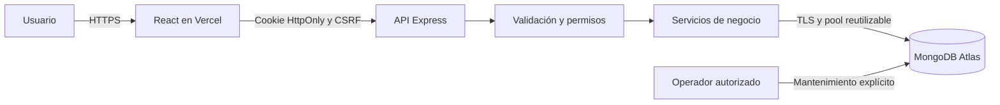

# Arquitectura y operación de SESHA APP

## Diseño

Se conserva un monolito modular: React y Vite sirven la interfaz; una API Express en Vercel aplica validaciones, autorización y reglas de negocio; MongoDB Atlas conserva los datos. No se necesitan microservicios para este alcance. Los modelos de cuenta (`empleados`) y perfil laboral (`perfiles_empleados`) son distintos y se vinculan mediante un identificador único; el nombre no identifica una cuenta.

Las rutas controlan HTTP, validan listas de campos permitidos y aplican permisos. Los servicios de autenticación gestionan bcrypt, sesiones y cambios atómicos. Los errores públicos omiten detalles internos. Los scripts de mantenimiento no se ejecutan en arranque, build o despliegue.

## Acceso de producción

- Vercel se trata como producción real: `NODE_ENV=production`, Node 24, orígenes HTTPS exactos y MongoDB con base explícita y TLS verificado. La conexión reutiliza el pool y no crea colecciones o índices automáticamente en producción.
- El registro público está cerrado en producción tanto en la ruta como en el servicio. `/api/auth/registration` informa a la interfaz; `/register` explica cómo solicitar el acceso. Un dominio de correo por sí solo no demuestra que alguien sea empleado.
- Desarrollo también mantiene el registro cerrado por defecto, para evitar altas ficticias si la API local apunta a Atlas. Solo se habilita explícitamente con `ALLOW_SELF_REGISTRATION=true` sobre datos de desarrollo desechables; en producción continúa cerrado aunque se configure esa variable. Las pruebas aisladas la habilitan expresamente.
- El administrador puede crear cuenta y perfil desde **Empleados → Nuevo empleado → Crear también su cuenta de acceso**. Introduce datos laborales verificados y una contraseña inicial oculta, de al menos 12 caracteres y máximo 72 bytes. Cuenta y perfil se crean en una transacción; un documento o correo duplicado revierte ambos. Nunca se acepta un rol enviado por el cliente.
- El administrador comunica el acceso por un canal privado; el empleado debe cambiar la contraseña inicial desde el login. No hay envío automático de credenciales, recuperación por correo ni cambio obligatorio en el primer acceso. Estas funciones requieren diseñar un mecanismo de invitación y verificación antes de añadirlas.
- El cambio de clave exige la anterior, guarda bcrypt de coste 12 e incrementa `sessionVersion`. Las sesiones usan cookies HttpOnly/Secure/SameSite y CSRF; los JWT se verifican contra el estado actual de la cuenta. Las respuestas no incluyen hashes ni JWT.
- Dos empleados homónimos utilizan correos y documentos diferentes. El sistema no reemplaza personas por coincidencia de nombre.

## Reactivación autorizada del 15/11/2026

Se reactivaron las 120 cuentas de la carga académica por solicitud expresa del propietario, después de un respaldo completo con restauración local verificada. Se retiró la etiqueta «Demo» de los nombres de cuenta y perfil y se reemplazaron los correos de esa carga por identificadores basados en nombre y número. No se aprovisionaron buzones. Cada cuenta recibió una contraseña aleatoria distinta con bcrypt de coste 12; sus credenciales anteriores no se reutilizaron y se incrementó `sessionVersion`.

La actualización de las dos colecciones fue transaccional, con comprobación de todos sus registros antes y después. Se conservaron los 152 identificadores de cuenta y perfil, los vínculos y los datos laborales. Las otras 19 cuentas en cuarentena permanecieron desactivadas. Los datos de la carga conservan su carácter académico. El módulo `backend/scripts/lib/activate-employee-accounts.js` exige destino y autorización explícitos, verifica cada contraseña y cancela ante cambios concurrentes, colisiones o un alcance distinto de las 120 cuentas originales. No se ejecuta durante el arranque ni el despliegue.

Los accesos se entregaron en un CSV local privado excluido de Git; no se publicaron contraseñas en informes, código ni Vercel. El cambio de datos se refleja en el despliegue existente sin recompilar la aplicación.

Validación: 17 pruebas aprobadas, lint del módulo y sus pruebas correcto, 120 contraseñas y perfiles vinculados comprobados directamente en MongoDB, y tres inicios de sesión con consulta del perfil y cierre de sesión correctos en `https://sesha-app.vercel.app`.

## Extensión al resto de cuentas del 15/11/2026

Una segunda solicitud autorizó renovar las contraseñas de los 31 empleados restantes, continuar sus correos con los consecutivos 121 a 151 y variar todos los números de documento. Se conservaron íntegros los accesos de los primeros 120 empleados y el acceso del administrador. El propietario confirmó por separado que el documento del administrador también debía actualizarse. Los 152 documentos nuevos son datos académicos sintéticos únicos, de longitudes variadas, sin los prefijos anteriores 97, 99 y 100000. No son documentos de identidad verificados.

Tras otro respaldo completo con restauración local verificada, una transacción renovó los 31 accesos con claves aleatorias únicas y bcrypt de coste 12, activó las 19 cuentas pendientes y actualizó los 152 perfiles. Se conservaron identificadores, nombres, cargos, áreas, fechas y asociaciones. Los registros históricos sin `sessionVersion` se trataron como versión cero, igual que la autenticación existente, y recibieron una versión nueva para revocar accesos anteriores. El módulo `backend/scripts/lib/complete-employee-dataset.js` verifica el alcance completo y revierte todas las escrituras ante errores o cambios concurrentes.

El CSV privado consolidado contiene los accesos de los 151 empleados y sus nuevos documentos, excluyendo las credenciales del administrador. Los archivos con claves y el plan completo permanecen en `.qa/`, fuera de Git y del despliegue. Estos cambios de datos se reflejan en Vercel sin desplegar código.

Validación de esta extensión: 22 pruebas aprobadas y lint correcto; 151 contraseñas verificadas contra MongoDB; 152 documentos nuevos y únicos (92 de ocho dígitos, 15 de nueve y 45 de diez). Se comprobaron seis accesos publicados, incluyendo cuentas antiguas y nuevas, sus perfiles con el documento actualizado, la descarga de sus constancias y el cierre de sesión. La cuenta del administrador se comparó íntegra con el respaldo previo de la operación y permaneció sin cambios.

## Remediación autorizada del 14/11/2026

Se verificaron el proyecto Vercel `sesha-app` y el destino Atlas `cluster1.nopuzfk.mongodb.net/proyecto_sena`. El propietario autorizó expresamente la cuarentena de las 120 cuentas demo, la rotación local y de producción del JWT y la publicación de las correcciones probadas.

Antes de escribir se creó un respaldo completo y se verificó su restauración únicamente en una base local temporal. Se desactivaron exactamente 120 cuentas `demo.exposicion.001` a `demo.exposicion.120`, incrementando sus versiones de sesión. No se eliminaron cuentas, cambiaron contraseñas, roles o perfiles. Las claves históricas de admin, Carlos y Laura ya no coinciden con sus hashes actuales. La cuarentena es idempotente y cancela toda la transacción si el alcance no coincide o falla una actualización.

La revisión ampliada de las otras cuentas detectó 19 empleados adicionales que aceptaban claves publicadas. El propietario autorizó expresamente su desactivación en una segunda operación, limitada al manifiesto privado de identificadores y correos. Se creó y restauró otro respaldo antes de aplicarla. La transacción revalidó las claves expuestas y preservó campos y otras cuentas. Resultado final: **139 cuentas desactivadas, 152 cuentas y perfiles conservados; las 13 cuentas activas no aceptan ninguno de los cuatro candidatos históricos revisados**. Admin, Carlos y Laura quedaron fuera de la segunda operación. Una cuenta desactivada no debe reactivarse sin sustituir primero su clave comprometida mediante un procedimiento autorizado.

Se generaron secretos JWT criptográficos independientes para local y producción; el valor nuevo de producción se guardó como secreto sensible de Vercel sin mostrarse ni persistir en informes. El despliegue de producción ya lo utiliza. El JWT firmado con el secreto histórico fue rechazado con HTTP 401 tanto en producción como en la API local, reiniciada con Node 24. No se debe restaurar el secreto anterior al hacer rollback.

Publicación verificada: commit `0c3fe01`, PR [#2](https://github.com/alexriver101219/PROYECTO_SENA/pull/2), despliegue Vercel `dpl_CyPvzr66VK6yjsFu7ZKX8cYcenec`, estado READY, dominio [sesha-app.vercel.app](https://sesha-app.vercel.app). CI de la rama aprobó antes de integrar. Las 12 comprobaciones posteriores verificaron disponibilidad, conexión a datos, cierre del registro, autenticación, archivos privados, CSP y coincidencia exacta del JavaScript publicado con el compilado probado. La consulta agrupada de logs de ese despliegue no devolvió grupos de error o fatal en los 15 minutos revisados. No se usaron contraseñas del propietario ni se escribieron datos de negocio durante esas peticiones.

## Controles de entrega

Validación local de esta versión: **64 pruebas de backend, 21 de frontend y 48 comprobaciones HTTP aprobadas** (133 en total), además de los dos límites de peticiones y 12 comprobaciones de publicación. Lint, build, escaneo dirigido de secretos configurados y verificación de publicación correctos. CI remoto también aprobó las pruebas y el escaneo de secretos de la entrega inicial. La revisión de dependencias informó cero vulnerabilidades conocidas; no se cambiaron dependencias de la aplicación durante la remediación.

CI ejecuta lint, pruebas, compilación, npm audit y un escáner de secretos fijado por versión y checksum. Las acciones están fijadas a commits verificados. El escáner de CI exporta el árbol versionado, sin copiar `.env` o archivos privados ignorados, y solo guarda metadatos de hallazgos. `.env*`, respaldos, sesiones de QA y herramientas portables no se publican en Git o Vercel. El frontend no incluye mapas de fuentes.

Se retiró `unsafe-inline` de la CSP y se trasladó el fondo de la portada a CSS externo. Se deshabilitó `X-Powered-By` también en los servidores de pruebas. La segunda ejecución de ZAP local dejó únicamente alertas informativas, sin alertas altas, medias o bajas en el alcance probado.

## Operación y límites

Antes de cualquier mantenimiento hay que verificar el destino y el alcance autorizado; mantener un respaldo privado y probar restauraciones. Los índices se administran mediante migraciones revisadas, nunca al arrancar funciones. Los registros deben contener estados y códigos, sin cuerpos de autenticación, cookies, claves, hashes o cadenas de conexión.

El historial conserva secretos retirados; quitar literales no elimina sus copias en clones o forks. La revocación de acceso se comprobó por separado. No se reescribe ni fuerza el historial remoto como parte de esta entrega. GitGuardian debe volver a evaluar las alertas concretas con las credenciales revocadas.

La aplicación no sustituye antivirus para PDF ni un sistema de gestión de secretos empresarial. No se comprobó la configuración administrativa de la red, privilegios o usuarios de Atlas, ni políticas organizativas de GitHub fuera del repositorio. El respaldo privado debe tener otra copia fuera de este equipo. Estas limitaciones no se presentan como controles ya implementados.

La automatización visual de esta revisión se bloqueó al no poder verificar la URL del navegador. Las pruebas de componentes y HTTP sí se completaron; el manual identifica las capturas anteriores como referencias. El informe de entrega debe distinguir comprobaciones locales de la verificación real posterior al despliegue.
