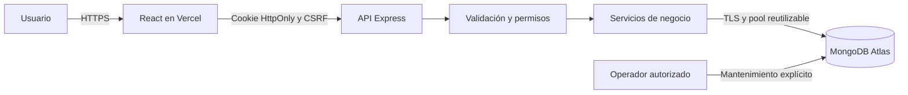

# Arquitectura y operación de SESHA APP

## Diseño

Se conserva un monolito modular: React y Vite sirven la interfaz; una API Express en Vercel aplica validaciones, autorización y reglas de negocio; MongoDB Atlas conserva los datos. No se necesitan microservicios para este alcance. Los modelos de cuenta (`empleados`) y perfil laboral (`perfiles_empleados`) son distintos y se vinculan mediante un identificador único; el nombre no identifica una cuenta.

Las rutas controlan HTTP, validan listas de campos permitidos y aplican permisos. Los servicios de autenticación gestionan bcrypt, sesiones y cambios atómicos. Los errores públicos omiten detalles internos. Los scripts de mantenimiento no se ejecutan en arranque, build o despliegue.

## Acceso de producción

- Vercel se trata como producción real: `NODE_ENV=production`, Node 24, orígenes HTTPS exactos y MongoDB con base explícita y TLS verificado. La conexión reutiliza el pool y no crea colecciones o índices automáticamente en producción.
- El registro público está cerrado en producción tanto en la ruta como en el servicio. `/api/auth/registration` informa a la interfaz; `/register` explica cómo solicitar el acceso. Un dominio de correo por sí solo no demuestra que alguien sea empleado.
- El administrador puede crear cuenta y perfil desde **Empleados → Nuevo empleado → Crear también su cuenta de acceso**. Introduce datos laborales verificados y una contraseña inicial oculta, de al menos 12 caracteres y máximo 72 bytes. Cuenta y perfil se crean en una transacción; un documento o correo duplicado revierte ambos. Nunca se acepta un rol enviado por el cliente.
- El administrador comunica el acceso por un canal privado; el empleado debe cambiar la contraseña inicial desde el login. No hay envío automático de credenciales, recuperación por correo ni cambio obligatorio en el primer acceso. Estas funciones requieren diseñar un mecanismo de invitación y verificación antes de añadirlas.
- El cambio de clave exige la anterior, guarda bcrypt de coste 12 e incrementa `sessionVersion`. Las sesiones usan cookies HttpOnly/Secure/SameSite y CSRF; los JWT se verifican contra el estado actual de la cuenta. Las respuestas no incluyen hashes ni JWT.
- Dos empleados homónimos utilizan correos y documentos diferentes. El sistema no reemplaza personas por coincidencia de nombre.

## Remediación autorizada del 14/11/2026

Se verificaron el proyecto Vercel `sesha-app` y el destino Atlas `cluster1.nopuzfk.mongodb.net/proyecto_sena`. El propietario autorizó expresamente la cuarentena de las 120 cuentas demo, la rotación local y de producción del JWT y la publicación de las correcciones probadas.

Antes de escribir se creó un respaldo completo y se verificó su restauración únicamente en una base local temporal. Se desactivaron exactamente 120 cuentas `demo.exposicion.001` a `demo.exposicion.120`, incrementando sus versiones de sesión. No se eliminaron cuentas, cambiaron contraseñas, roles o perfiles. Las claves históricas de admin, Carlos y Laura ya no coinciden con sus hashes actuales. La cuarentena es idempotente y cancela toda la transacción si el alcance no coincide o falla una actualización.

Se generaron secretos JWT criptográficos independientes para local y producción; el valor nuevo de producción se guardó como secreto sensible de Vercel sin mostrarse ni persistir en informes. La activación depende del nuevo despliegue. No se debe restaurar el secreto anterior al hacer rollback.

## Controles de entrega

Validación local de esta versión: **59 pruebas de backend, 21 de frontend y 48 comprobaciones HTTP aprobadas** (128 en total), además de los dos límites de peticiones. Lint, build, escaneo dirigido de secretos configurados y verificación de publicación correctos. La revisión de dependencias anterior informó cero vulnerabilidades conocidas; no se cambiaron dependencias de la aplicación durante la remediación.

CI ejecuta lint, pruebas, compilación, npm audit y un escáner de secretos fijado por versión y checksum. Las acciones están fijadas a commits verificados. El escáner de CI exporta el árbol versionado, sin copiar `.env` o archivos privados ignorados, y solo guarda metadatos de hallazgos. `.env*`, respaldos, sesiones de QA y herramientas portables no se publican en Git o Vercel. El frontend no incluye mapas de fuentes.

Se retiró `unsafe-inline` de la CSP y se trasladó el fondo de la portada a CSS externo. Se deshabilitó `X-Powered-By` también en los servidores de pruebas. La segunda ejecución de ZAP local dejó únicamente alertas informativas, sin alertas altas, medias o bajas en el alcance probado.

## Operación y límites

Antes de cualquier mantenimiento hay que verificar el destino y el alcance autorizado; mantener un respaldo privado y probar restauraciones. Los índices se administran mediante migraciones revisadas, nunca al arrancar funciones. Los registros deben contener estados y códigos, sin cuerpos de autenticación, cookies, claves, hashes o cadenas de conexión.

El historial conserva secretos retirados; quitar literales no elimina sus copias en clones o forks. La revocación de acceso se comprobó por separado. No se reescribe ni fuerza el historial remoto como parte de esta entrega. GitGuardian debe volver a evaluar las alertas concretas con las credenciales revocadas.

La aplicación no sustituye antivirus para PDF ni un sistema de gestión de secretos empresarial. No se comprobó la configuración administrativa de la red, privilegios o usuarios de Atlas, ni políticas organizativas de GitHub fuera del repositorio. El respaldo privado debe tener otra copia fuera de este equipo. Estas limitaciones no se presentan como controles ya implementados.

La automatización visual de esta revisión se bloqueó al no poder verificar la URL del navegador. Las pruebas de componentes y HTTP sí se completaron; el manual identifica las capturas anteriores como referencias. El informe de entrega debe distinguir comprobaciones locales de la verificación real posterior al despliegue.
